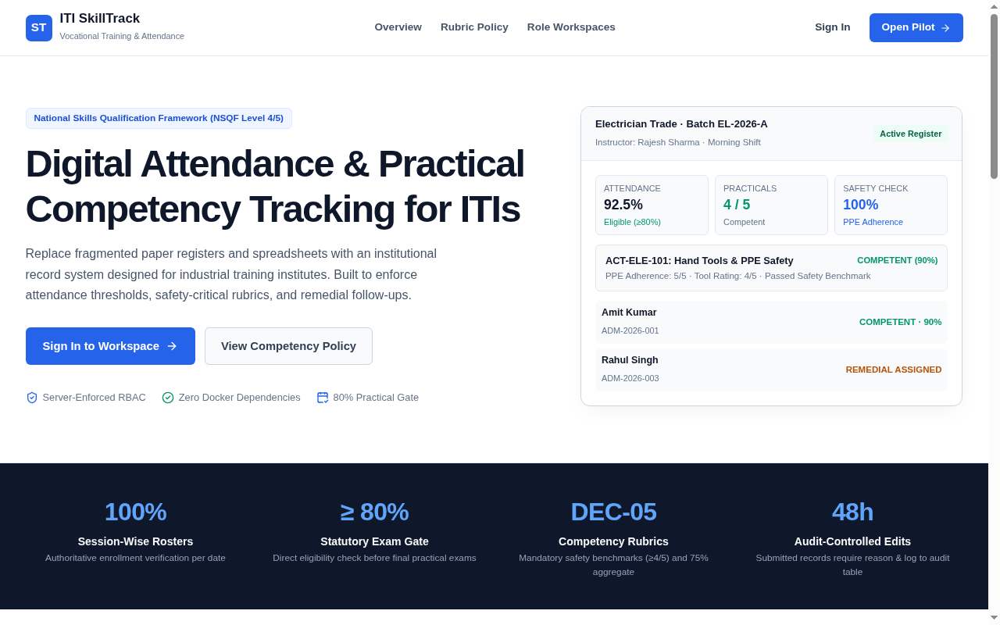
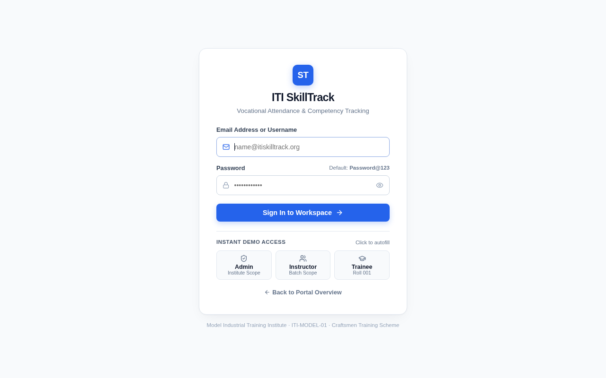

# ITI SkillTrack: Institutional Practical Training, Attendance, Competency & Verification Platform

> **Authoritative Digital Record System for Industrial Training Institutes (ITIs)**  
> *Craftsmen Training Scheme (CTS) · Directorate General of Training (DGT) · National Skills Qualification Framework (NSQF Level 4/5)*  
> *Student Startup and Innovation Policy (SSIP 2025) · Smart Future Innovation Challenge (SFIC 2026)*

[](https://github.com/)

[](docs/tasks.md)
[](#-zero-docker-local-development-setup)
[](#-comprehensive-database-schema--data-dictionary)
[](#-security-hardening--compliance-framework)

---

## 📑 Table of Contents
1. [Live Production Deployments & Visual Gallery](#-live-production-deployments--visual-gallery)
2. [Executive Summary & Institutional Differentiation](#-executive-summary--institutional-differentiation)
3. [Key System Invariants & Statutory Rules](#-key-system-invariants--statutory-rules)
4. [System Architecture & Technical Topology](#-system-architecture--technical-topology)
5. [Statutory Policy Decision Register (DEC-01 to DEC-12)](#-statutory-policy-decision-register-dec-01-to-dec-12)
6. [Complete Engineering Implementation Register (Phases 0–11)](#-complete-engineering-implementation-register-phases-011)
7. [Comprehensive Database Schema & Data Dictionary](#-comprehensive-database-schema--data-dictionary)
8. [Complete REST API Endpoint Reference](#-complete-rest-api-endpoint-reference)
9. [Role-Based Access Control (RBAC) & All-Pages Matrix](#-role-based-access-control-rbac--all-pages-matrix)
10. [Pre-Seeded Pilot Accounts & Evaluation Scenarios](#-pre-seeded-pilot-accounts--evaluation-scenarios)
11. [Zero-Docker Local Development Setup](#-zero-docker-local-development-setup)
12. [Production & InfinityFree Deployment Guide (`htdocs.zip`)](#-production--infinityfree-deployment-guide-htdocszip)
13. [Security Hardening & Compliance Framework](#-security-hardening--compliance-framework)
14. [Testing, Quality Assurance & Verification Matrix](#-testing-quality-assurance--verification-matrix)
15. [Project Directory Structure](#-project-directory-structure)
16. [Governance, SSIP 2025 / SFIC 2026 Initiative & License](#-governance-ssip-2025--sfic-2026-initiative--license)

---

## 🌐 Live Production Deployments & Visual Gallery

### Live Hosted Instances
| Instance | URL | Environment & Database | Highlighted Capabilities |
|---|---|---|---|
| **Primary ITI Portal** | [https://iti.rf.gd](https://iti.rf.gd) | Apache + PHP 8.x + MySQL / SQLite | Full Institutional Portal, Attendance Gate & DEC-05 Competency Matrix |
| **Latest Multi-Phase Build** | [https://iti3.rf.gd](https://iti3.rf.gd) | InfinityFree MySQL (`if0_43194312_iti_skilltrack`) | Phases 0–11 including Batch Quizzes, GUJ‑ITI Directory & Geo-Tagged Practical Photo Dual Approval |
| **Pilot Trade Instance** | [https://piti.site.je](https://piti.site.je) | Production SPA + REST API | CTS Practical Training, Remedial Queue, AITT Eligibility & Audit Reports |

---

### 📸 Visual Interface Gallery

#### 1. Institutional Portal & Practical Registry Overview

*Figure 1: Institutional landing portal showcasing statutory attendance compliance, DEC-05 competency rubrics, lifecycle progression, and role entry points (`/home`).*

#### 2. Zero-Scroll Authentication Card & Instant Role Testing

*Figure 2: Strict single-viewport (`100vh`) authentication interface eliminating viewport scrolling, complete with 1-click test account presets for Administrator, Vocational Instructor, and Student Trainee (`/login`).*

#### 3. Role-Scoped Vocational Dashboard & Live Oversight

*Figure 3: Live operational workspace displaying cohort metrics, session register completion, statutory 80% attendance eligibility alerts, and active remedial queues.*

> [!NOTE]
> Additional per-role page screenshots captured via Chrome DevTools across `https://iti.rf.gd`, `https://iti3.rf.gd`, and `https://piti.site.je` can be placed in [`docs/screenshots/`](docs/screenshots/) to extend this visual gallery. See the [All-Pages Route Matrix](#-all-role-pages-route-coverage) below for every route across all 4 user roles.

---

## 🎯 Executive Summary & Institutional Differentiation

Across **Industrial Training Institutes (ITIs)** operating under the **Craftsmen Training Scheme (CTS)** and **Directorate General of Training (DGT)**, practical workshop training accounts for **60% to 70%** of instructional hours. Traditional campus ERP tools focus on generic theory marks and fees while leaving hands-on workshop evaluation on paper.

### Core Pain Points Solved
1. **Paper Attendance Logbooks → Session-Scoped Digital Registers:** Eliminates fragile daily paper registers by linking attendance directly to scheduled workshop sessions, instructors, and equipment blocks.
2. **Last-Minute Exam Disqualifications → Live 80% Statutory Gate Tracking:** Continuously computes DGT practical attendance eligibility so shortfalls are flagged immediately rather than weeks before All India Trade Test (AITT) registration.
3. **Subjective Practical Grading → DEC-05 Safety-Critical Rubric Engine:** Replaces arbitrary marks with 0–5 criterion rubrics where any safety failure automatically triggers structured remedial practice.
4. **Unverified Practical Submissions → Geo-Tagged Photo Verification with Dual Approval Gate:** Requires trainees to capture live workshop GPS coordinates and upload a practical photo stored on disk, approved by **both** the Instructor and Administrator before practical evaluation can be finalized.
5. **Unstructured Assessments → Batch-Scoped Quiz Engine & Multi-ITI Governance:** Pairs practical lab mastery with instant-evaluation batch quizzes (hidden answer keys, 2.5-second result reveal) and a Gujarat-wide **GUJ‑ITI** directory.

### Why Choose ITI SkillTrack?
* **DEC-05 Safety-First Grading:** Hard-enforces mandatory workshop safety ($\ge 4/5$ on safety criteria AND $\ge 75\%$ aggregate score) before awarding competency.
* **Geo-Tagged Practical Proof & Dual Approval:** Embedded OpenStreetMap GPS pin + disk-stored image evidence requiring **both Instructor and Admin approval** (with rejection reason & student re-upload loop).
* **Automated Remedial Feedback Loop:** Automatically assigns targeted corrective tasks when safety or score thresholds are missed, tracking follow-up hours through resolution.
* **True Zero-Docker Shared Hosting Portability:** Runs natively on standard PHP 8.x + MySQL/MariaDB (including InfinityFree / cPanel) with an automatic zero-config SQLite 3 fallback.
* **Server-Side Multi-Tenant & IDOR Protection:** Enforces `institute_id` and role/batch scoping across every API endpoint, backed by CSRF tokens, HttpOnly cookies, formula-sanitized CSV exports, and an immutable audit trail.

---

## ⚖️ Key System Invariants & Statutory Rules

ITI SkillTrack enforces non-negotiable operational invariants at both the **database constraint level** and **domain service layer**:

* **Invariant 1 — Unique Session Attendance (`UNIQUE (session_id, student_id)`):** Each trainee holds at most one authoritative attendance status per training session.
* **Invariant 2 — No Blank Submissions:** Attendance registers cannot be submitted while enrolled trainees have missing marks.
* **Invariant 3 — Statutory 80% Practical Attendance Gate:** Trainees require at least 80% attendance to qualify for semester practical examinations:
  $$\text{Attendance } \% = \frac{\text{Present} + \text{Late}}{\text{Total Sessions} - \text{Excused}} \times 100$$
* **Invariant 4 — DEC-05 Safety-Critical Competency Gate:** A trainee **cannot** earn `competent` if **any** safety-critical criterion scores below **4 out of 5**, even when total score exceeds 75%.
* **Invariant 5 — Dual-Approved Geo-Photo Gate Before Practical Submission:** Practical assessment submission (`POST /api/v1/assessments`) is blocked (`422 PHOTO_APPROVAL_REQUIRED`) unless the student's geo-tagged practical photo has `overall_status = 'approved'` (approved by **both** Instructor and Administrator). Rejections by either role permit immediate student re-upload.
* **Invariant 6 — Tamper-Resistant Audit Journal:** Post-submission corrections and state mutations require explicit justification and emit immutable records into `audit_logs`.

---

## 🏗️ System Architecture & Technical Topology

ITI SkillTrack is engineered as a **modular monolith** built for zero-container cloud & shared Linux hosting:

```
+----------------------------------------------------------------------------------------+
|                                     CLIENT TIER                                        |
|                                                                                        |
|  React 19 SPA (Vite 8) · React Router v7 · Lucide Icons · Custom Design Tokens         |
|  - Zero-Scroll Single-Viewport Auth (/login) & Role Dashboards                         |
|  - Attendance Register, Batch Competency Matrix & Remedial Queue                       |
|  - Batch Quiz Builder & Student Quiz Portal (2.5s Evaluation Reveal)                   |
|  - Geo-Tagged Photo Capture + OpenStreetMap Pin Preview (GeoMapPreview.jsx)            |
|  - Admin GUJ-ITI Multi-City Directory (/admin/guj-iti) & System Telemetry              |
+-------------------------------------------+--------------------------------------------+
                                            |
                                            | JSON REST API + Multipart Upload / HTTPS
                                            | (X-CSRF-Token Header + HttpOnly Cookie)
                                            v
+----------------------------------------------------------------------------------------+
|                               APPLICATION SERVICES TIER                                |
|                                                                                        |
|  PHP 8.x REST API · PSR-4 Autoloading · Custom Router (`App\Support\Router`)           |
|  +----------------------------------------------------------------------------------+  |
|  | Middleware: RequestIdMiddleware · CorsMiddleware · AuthMiddleware · CsrfMiddleware  |  |
|  |             RoleMiddleware (`administrator`, `instructor`, `student`, `monitoring`) |  |
|  +----------------------------------------------------------------------------------+  |
|  | Domain Services (`backend/src/Services/`):                                       |  |
|  |  * AttendanceService       (Session rosters, 80% gate, 48h controlled corrections)  |  |
|  |  * CompetencyService       (DEC-05 safety gating, rubrics, dual-photo submission)   |  |
|  |  * PracticalPhotoService   (Disk image storage, GPS checks, dual Inst+Admin review)|  |
|  |  * QuizService             (Batch quizzes, hidden answer keys, instant grading)     |  |
|  |  * GujiTiService           (Gujarat multi-city ITI registry & auto-seeding)         |  |
|  |  * RemedialService / ReportService / AuditService / SystemService                   |  |
|  +----------------------------------------------------------------------------------+  |
+-------------------------------------------+--------------------------------------------+
                                            |
                                            | PDO Prepared Statements
                                            | Dual-Driver Database Abstraction
                                            v
+----------------------------------------------------------------------------------------+
|                               PERSISTENCE & FILE STORAGE                               |
|                                                                                        |
|  Production: MySQL 8.x / MariaDB 10.x (InfinityFree)  | Dev/Fallback: SQLite 3 Engine   |
|  - Normalized Tables + Idempotent `ensureSchema()`     | - Zero-Config Auto Fallback   |
|                                                                                        |
|  Server Filesystem Storage:                                                            |
|  - `backend/storage/private_uploads/`   (DEC-08 practical rubric evidence PDFs/Images) |
|  - `backend/storage/practical_photos/`  (Geo-tagged student practical photos)          |
+----------------------------------------------------------------------------------------+
```

### Standard API Envelope
All JSON endpoints return a consistent response envelope via `App\Support\Response`:
```json
{
  "status": "success",
  "data": {},
  "meta": { "timestamp": "2026-11-27T15:30:00Z", "request_id": "req_9f2a1c" }
}
```

---

## 📜 Statutory Policy Decision Register (DEC-01 to DEC-12)

| Policy ID | Area | Institutional Policy Specification | Enforcement Layer |
|---|---|---|---|
| **DEC-01** | Multi-Tenancy Scope | Single-institute deployment with strict `institute_id` column scoping across entities for multi-institute federation. | Database + Middleware |
| **DEC-02** | Attendance Unit | Session-level practical/lab attendance (`training_sessions`) linked to batch, instructor, date, and topic. | DB Unique Keys |
| **DEC-03** | Attendance Gate | Statutory **80%** attendance threshold (`present`, `late`, `absent`, `excused`; excused excluded from denominator). | `AttendanceService` |
| **DEC-04** | Pilot Curriculum | CTS **Electrician (`ELE-01`)** NSQF Level 4/5 hierarchy: `Trade -> Modules -> Practical Activities -> Criteria`. | `001_initial_schema.sql` |
| **DEC-05** | Practical Rubrics | 0–5 scoring; `competent` requires **100% of safety criteria $\ge 4/5$** AND **aggregate score $\ge 75\%$**. | `CompetencyService` |
| **DEC-06** | Role Permissions | 4 strict roles: `administrator`, `instructor`, `student`, `monitoring_officer` (read-only oversight). | `RoleMiddleware` |
| **DEC-07** | Correction Windows | Post-submit edits within 48 hours require $\ge 10$-char justification and append to `audit_logs`; >48h requires Admin. | `AttendanceService` |
| **DEC-08** | File Storage | Max 5MB images/PDFs stored on disk in private `storage/` directories, streamed only after session & scope validation. | `EvidenceController` / `PracticalPhotoController` |
| **DEC-09** | CSV Sanitization | Prefixes spreadsheet formula triggers (`=`, `+`, `-`, `@`, `\t`, `\r`) with `'` on CSV exports. | `ReportService` / `AttendanceService` |
| **DEC-10** | Data Retention | 5-year trainee practical, rubric, quiz, geo-photo, and audit history retention. | Persistence Policy |
| **DEC-11** | Pilot Cohort | Electrician (`ELE-01`), Batch `EL-2026-A`, Academic Period `2026–2027`, Instructor Rajesh Sharma (`INST-001`). | Database Seeders |
| **DEC-12** | Quality Gates | Zero Docker dependency, 100% route parity across entrypoints, zero-scroll auth card, automated self-tests. | Build & QA Suite |

---

## 🚀 Complete Engineering Implementation Register (Phases 0–11)

### Phases 0–5: Foundation, Organization, Attendance, Competency & Remedials
* **Phase 0–2 (Governance & Auth):** Defined `DEC-01..DEC-12`, built React 19 SPA + PHP 8 REST API with Bcrypt hashing, HttpOnly sessions, CSRF verification, and complete master data CRUD (`Institutes`, `Departments`, `Trades`, `Academic Periods`, `Batches`, `Students`, `Instructors`, `Users`).
* **Phase 3 (Training Sessions & Attendance):** Session scheduling, dynamic enrollment-as-of-date rosters, draft/submit locking, 48h correction workflow, 80% eligibility tracking, and formula-sanitized CSV exports.
* **Phase 4–5 (Practical Rubrics, Remedials & Role Workspaces):** 0–5 criterion evaluations with DEC-05 safety gating, automated remedial task creation on failed safety/percentage benchmarks, instructor remedial review modals, student portfolio (`/student/skills`), and dedicated dashboards for Admin, Instructor, and Student.

### Phases 6–8: Institutional Reports, Audit Trail, UAT & Multi-Trade Rollout
* **Phase 6 (Reports Hub, Forensic Audit & Evidence Storage):** Attendance Summary, Competency Mastery Matrix, DGT/AITT Eligibility Roster (`/reports`), append-only JSON diff audit viewer (`/admin/audit-logs`), and authenticated `EvidenceController` file streaming.
* **Phase 7 (UAT & Parallel Reconciliation Center):** Interactive persona checklists, live UAT assertion runner (`GET /api/v1/system/uat/run`), and paper-vs-digital reconciliation matrix (`/admin/uat`).
* **Phase 8 (Production Health & 1-Click Trade Expansion):** Operational telemetry center (`/admin/system-health`), SQL database snapshot download (`GET /api/v1/system/backup`), and 1-click provisioning (`POST /api/v1/system/rollout/trade`) for **Fitter (`FIT-01`)**, **Welder (`WEL-01`)**, and **COPA (`COPA-01`)** trades.

### Phase 9: Batch Quizzes & Instant Evaluation
* **Staff Quiz Manager (`/quizzes`):** Admins and Instructors create batch-assigned MCQ quizzes with per-question marks, time limit, passing percentage, and correct option (`A`–`D`), toggle quiz status (`published`/`closed`), inspect answer keys, review student submissions (`Results`), and **delete quizzes** (with cascade cleanup and `QUIZ_DELETED` audit log).
* **Student Quiz Portal (`/student/quizzes`):** Displays published quizzes scoped strictly to the student's active batch, **strips `correct_option` server-side**, runs a 2.5-second evaluation feedback indicator on submission, stores graded attempts (`quiz_attempts`, `quiz_attempt_answers`), and reveals marks and pass status cleanly.

### Phase 10: GUJ‑ITI Multi-City Institute Directory
* **Admin-Only Directory (`/admin/guj-iti`):** Protected by `$adminMw` and `administrator` route guard. Displays all registered Gujarat ITIs with institute name, code, city, and operational status (`active`/`inactive`), plus an **Add ITI** creation workflow.
* **Zero-Config Schema & City Seeding (`GujiTiService` + Migration `005`):** Automatically creates the `itis` table (MySQL & SQLite) and seeds 3 regional Gujarat ITIs in distinct cities:
  * **Government ITI Kubernagar** (`GUJ-AMD-01`) — Ahmedabad (`active`)
  * **Government ITI Majura Gate** (`GUJ-SRT-01`) — Surat (`active`)
  * **Government ITI Aji Dam** (`GUJ-RJK-01`) — Rajkot (`active`)

### Phase 11: Geo-Tagged Practical Photo Verification & Dual Approval Gate
* **Geo-Tagged Photo Upload & Disk Storage (`StudentSkillsPage.jsx`, `GeoMapPreview.jsx`, `PracticalPhotoService.php`):**
  * Before practical evaluation, students capture live GPS coordinates (`navigator.geolocation` with manual coordinate fallback), attach an image (`JPG`, `PNG`, `WEBP`, up to 5 MB), preview the photo alongside an **embedded OpenStreetMap geo-pin**, and submit via `FormData` (`api.upload()`).
  * Images are saved on the server filesystem under `storage/practical_photos/` (and `htdocs/api/storage/practical_photos/`) and streamed securely through `GET /api/v1/practical-photos/{id}/file`.
* **Dual Approval Gate (`instructor_status` + `admin_status`):**
  * `AssessmentWorkspacePage.jsx` surfaces a **Geo-Tagged Practical Photo Verification Queue** showing uploaded photos, GPS coordinates, embedded geo-map, and approval badges.
  * **Both Instructor AND Administrator** must approve (`overall_status = 'approved'`) before practical rubric evaluation (`POST /api/v1/assessments`) is permitted; partial approval sets `overall_status = 'partially_approved'`.
  * **Rejection & Student Re-upload:** If either Instructor or Admin rejects (requiring remarks), `overall_status` becomes `rejected`, displaying the reason to the student and unlocking **Re-upload Geo Photo**, which replaces the stored file and resets both approval stages to `pending`.
  * **Clean Post-Acceptance UX:** Once both Instructor and Admin accept (`overall_status === 'approved'`) — or once the practical is already evaluated — the **Upload Geo Photo** button is removed and replaced with **Submit Practical** (`POST /api/v1/practical-photos/{id}/submit-practical`), initializing the practical attempt for final staff grading.

---

## 🗄️ Comprehensive Database Schema & Data Dictionary

The database spans **31+ tables** across six versioned migration sets (providing identical schemas for **MySQL 8.x / MariaDB** and **SQLite 3**):

| Migration File (MySQL / SQLite) | Domain & Key Tables |
|---|---|
| `001_initial_schema*.sql` | Core org & RBAC: `institutes`, `departments`, `trades`, `academic_periods`, `batches`, `users`, `roles`, `user_roles`, `instructors`, `students`, `enrollments`, `instructor_assignments`, `audit_logs`, `system_settings` |
| `002_phase3_attendance*.sql` | Sessions & Attendance: `training_sessions`, `attendance_statuses`, `attendance_records`, `attendance_corrections` |
| `003_phase4_phase5_competency_remedial*.sql` | Curriculum, Rubrics & Remedials: `modules`, `practical_activities`, `competency_criteria`, `activity_attempts`, `assessments`, `assessment_criterion_results`, `evidence_uploads`, `remedial_assignments`, `remedial_reviews` |
| `004_phase9_quizzes*.sql` | Batch Quizzes: `quizzes`, `quiz_questions`, `quiz_attempts`, `quiz_attempt_answers` |
| `005_phase10_guj_iti*.sql` | Multi-City Directory: `itis` (`id`, `name`, `code`, `city`, `state`, `status`, `created_at`) + 3 seeded Gujarat ITIs |
| `006_phase11_practical_photos*.sql` | Geo-Photo Gate: `practical_photo_submissions` (`file_name`, `file_path`, `latitude`, `longitude`, `accuracy_meters`, `location_label`, `instructor_status`, `admin_status`, `overall_status`, `practical_submitted_at`, `practical_notes`, etc.) |

---

## 🔌 Complete REST API Endpoint Reference

All API routes are defined identically across [`backend/index.php`](backend/index.php), [`backend/public/index.php`](backend/public/index.php), [`htdocs/api/index.php`](htdocs/api/index.php), and [`htdocs/api/public/index.php`](htdocs/api/public/index.php).

### 1. Health, Auth & Master Organization Data
| Method | Endpoint | Access | Purpose |
|---|---|---|---|
| `GET` | `/api/v1/health` | Public | System & DB driver connectivity check |
| `GET` | `/api/v1/config` | Public | Public institute metadata & statutory rule baselines |
| `POST` | `/api/v1/auth/login` | Public | Authenticates session, sets cookie + returns CSRF token |
| `POST` | `/api/v1/auth/logout` | Authenticated | Destroys session |
| `GET` | `/api/v1/auth/me` | Authenticated | Current user profile, role & capabilities |
| `GET` | `/api/v1/auth/csrf` | Public | Issues/refreshes CSRF token |
| `GET` / `PUT` | `/api/v1/institute` | Auth / Admin | Read or update institute profile |
| `GET` / `POST` / `PUT` | `/api/v1/departments`, `/trades`, `/academic-periods`, `/batches` | Auth / Admin | Organization hierarchy CRUD (plus status toggle on trades) |
| `GET` / `POST` / `PUT` | `/api/v1/students`, `/instructors`, `/users` | Auth / Admin | Directory management, enrollments, assignments, role updates & password resets |

### 2. Sessions, Attendance, Competency & Remedials
| Method | Endpoint | Access | Purpose |
|---|---|---|---|
| `GET` / `POST` / `PUT` | `/api/v1/sessions`, `/api/v1/sessions/{id}` | Auth / Staff | Workshop session scheduling & cancellation |
| `GET` / `PUT` / `POST` | `/api/v1/sessions/{id}/attendance`, `/submit` | Auth / Staff | Roster attendance draft save, submit & lock |
| `PATCH` | `/api/v1/attendance/records/{id}` | Staff | Controlled post-submit attendance correction |
| `GET` | `/api/v1/attendance/report`, `/report/export`, `/students/{id}/attendance` | Auth (Scoped) | Attendance matrix, 80% gate check & CSV export |
| `GET` / `POST` / `PUT` | `/api/v1/curriculum`, `/activities/{id}`, `/modules`, `/activities` | Auth / Admin | Curriculum modules & rubric criteria |
| `POST` | `/api/v1/attempts`, `/api/v1/assessments` | Staff | Initialize attempts & submit DEC-05 evaluations (enforces dual geo-photo approval) |
| `GET` | `/api/v1/batches/{batch_id}/competency-matrix`, `/students/{id}/competency` | Auth (Scoped) | Batch skill matrix & trainee competency portfolio |
| `GET` / `POST` | `/api/v1/remedials`, `/api/v1/remedials/{id}/review` | Auth / Staff | Remedial queue & resolution reviews |

### 3. Reports, Audit Trail, Evidence, UAT & Telemetry
| Method | Endpoint | Access | Purpose |
|---|---|---|---|
| `GET` | `/api/v1/audit-logs`, `/api/v1/dashboard/stats` | Auth | Audit log explorer & dashboard aggregates |
| `GET` | `/api/v1/reports/attendance-summary` (+ `/export`), `/competency-mastery` (+ `/export`), `/aitt-eligibility` (+ `/export`), `/remedial-summary` | Auth | Statutory institutional reports & sanitized CSV exports |
| `POST` / `GET` | `/api/v1/evidence/upload`, `/api/v1/evidence/{id}/download` | Staff / Auth | DEC-08 private evidence upload & streaming |
| `GET` / `POST` | `/api/v1/system/uat/run`, `/uat/reconciliation`, `/health/operational`, `/rollout/trade`, `/backup` | Auth / Admin | Live UAT runner, health telemetry, multi-trade rollout & SQL backup |

### 4. Phase 9, 10 & 11 Endpoints (Quizzes, GUJ‑ITI & Geo-Tagged Practical Photos)
| Method | Endpoint | Access | Purpose |
|---|---|---|---|
| `GET` | `/api/v1/quizzes` | Authenticated | List quizzes (role- & batch-scoped) |
| `GET` | `/api/v1/quizzes/{id}` | Authenticated | Fetch quiz questions (`correct_option` stripped for students) |
| `POST` | `/api/v1/quizzes` | Staff | Create batch quiz with questions & correct options |
| `PATCH` | `/api/v1/quizzes/{id}/status` | Staff | Toggle quiz status (`published` / `closed`) |
| `GET` | `/api/v1/quizzes/{id}/results` | Staff | View batch student marks & pass status |
| `POST` | `/api/v1/quizzes/{id}/submit` | Auth + CSRF | Student quiz submission & instant evaluation |
| `DELETE` | `/api/v1/quizzes/{id}` | Staff | Delete quiz with cascade cleanup & audit logging |
| `GET` / `POST` | `/api/v1/guj-iti` | Admin | List Gujarat ITIs across cities or add a new ITI |
| `GET` | `/api/v1/practical-photos` | Authenticated | List geo-tagged practical photo submissions (role-scoped) |
| `POST` | `/api/v1/practical-photos` | Auth + CSRF | Upload or re-upload geo-tagged practical photo to disk |
| `POST` | `/api/v1/practical-photos/{id}/review` | Staff | Instructor or Admin approve / reject (with remarks) |
| `POST` | `/api/v1/practical-photos/{id}/submit-practical` | Auth + CSRF | Student finalizes practical submission after dual approval |
| `GET` | `/api/v1/practical-photos/{id}/file` | Authenticated | Stream stored geo-tagged practical photo from disk |

---

## 👥 Role-Based Access Control (RBAC) & All-Pages Matrix

### Authorization Matrix
| Capability | Administrator | Instructor | Student | Monitoring Officer |
|---|:---:|:---:|:---:|:---:|
| **GUJ‑ITI Multi-City Directory (`/admin/guj-iti`)** | Full Access | — | — | — |
| **Users, Roles, Settings, System Health** | Full Access | — | — | — |
| **Students, Instructors, Trades, Batches, Periods** | Full Access | — | — | Read-Only |
| **Audit Logs & UAT Verification** | Full Access | — | — | Read-Only |
| **Batch Quiz Creation, Results, Toggle & Delete** | Full Access | Assigned Batches | Attempt Own Batch | — |
| **Practical Photo Verification (Dual Gate)** | Admin Approval | Instructor Approval | Upload / Re-upload / Submit | — |
| **Practical Rubric Assessments & Remedials** | Full Access | Assigned Batches | View Own Portfolio | Read-Only |
| **Training Sessions & Attendance Registers** | Full Access | Assigned Batches | View Own Attendance | Read-Only |

### All Role Pages Route Coverage
Defined in [`frontend/src/App.jsx`](frontend/src/App.jsx) and [`frontend/src/components/layout/AppLayout.jsx`](frontend/src/components/layout/AppLayout.jsx):
* **Public & Account:** `/` (`HomePage`), `/login` (`LoginPage`), `/profile` (`ProfilePage`)
* **Administrator (`/admin/*` + shared):** `/admin/dashboard`, `/admin/guj-iti`, `/reports`, `/admin/audit-logs`, `/admin/uat`, `/admin/system-health`, `/sessions`, `/sessions/:id/attendance`, `/curriculum`, `/assessments`, `/quizzes`, `/remedials`, `/admin/students`, `/admin/instructors`, `/admin/trades`, `/admin/academic-periods`, `/admin/batches`, `/admin/users`, `/admin/settings`
* **Vocational Instructor:** `/instructor/dashboard`, `/instructor/batches`, `/attendance/report`, `/assessments`, `/quizzes`, `/remedials`, `/sessions`, `/curriculum`, `/reports`
* **Student Trainee:** `/student/dashboard`, `/student/quizzes`, `/student/skills` (Geo-Photo Upload/Approval & Submit Practical), `/student/attendance`
* **Monitoring Officer:** Read-only access across `/admin/dashboard`, `/reports`, `/admin/audit-logs`, `/admin/uat`, `/assessments`, `/remedials`, `/sessions`, `/curriculum`, `/admin/students`, `/admin/instructors`, `/admin/trades`, `/admin/batches`

---

## 🔑 Pre-Seeded Pilot Accounts & Evaluation Scenarios

Default pilot data targets **Electrician Trade (`ELE-01`)**, Batch **`EL-2026-A`**, Academic Period **`2026–2027`**:

| Role | Email Address | Password | Verification Scenario |
|---|---|---|---|
| **Administrator** | `admin@itiskilltrack.org` | `Password@123` | Full governance, **GUJ‑ITI Directory** (`/admin/guj-iti`), 2nd-stage practical photo approval, audit logs & telemetry. |
| **Instructor** | `rajesh.sharma@itiskilltrack.org` | `Password@123` | Assigned to Batch `EL-2026-A`. Schedules sessions, creates quizzes, performs 1st-stage practical photo approval & rubric grading. |
| **Student 1 (Eligible)** | `amit.kumar@student.iti.org` | `Password@123` | 92.5% attendance, eligible for exams, attempts batch quizzes & uploads geo-tagged practical photos. |
| **Student 2 (Remedial)** | `rahul.singh@student.iti.org` | `Password@123` | Active remedial task candidate demonstrating DEC-05 safety remedial routing. |

---

## ⚡ Zero-Docker Local Development Setup

### Prerequisites
* **Node.js** 18+ and **npm**
* **PHP** 8.1+ with `pdo_sqlite`, `pdo_mysql`, and `fileinfo` extensions

### Launch Backend & Frontend Locally
```bash
# 1. Install and build frontend
cd frontend
npm install

# 2. Start PHP API server (auto-uses SQLite if configured / MySQL via backend/.env)
cd ../backend
php -S 127.0.0.1:8000 public/index.php

# 3. In another terminal, start Vite dev server
cd ../frontend
npm run dev
```
Open **`http://localhost:5173`** (Vite proxies `/api/*` directly to the PHP backend).

---

## 📦 Production & InfinityFree Deployment Guide (`htdocs.zip`)

The repository includes a ready-to-upload production build in `htdocs/` and packaged archive [`htdocs.zip`](htdocs.zip) (frontend compiled into `htdocs/assets/`, PHP REST API in `htdocs/api/`, pre-seeded SQLite fallback, and production `.env`).

### Deployment Steps (cPanel / InfinityFree / Apache)
1. Upload [`htdocs.zip`](htdocs.zip) to your hosting root and extract so `index.html`, `assets/`, and `api/` sit directly inside your web root (`htdocs/` or `public_html/`).
2. Configure MySQL credentials in `api/.env`:
   ```ini
   DB_CONNECTION=mysql
   DB_HOST=sql308.infinityfree.com
   DB_PORT=3306
   DB_DATABASE=if0_43194312_iti_skilltrack
   DB_USERNAME=if0_43194312
   DB_PASSWORD=your_mysql_password
   DB_FALLBACK_SQLITE=true
   ```
3. **Database Tables (Auto-Created or Manual SQL Import):**
   * Both [`QuizService.php`](backend/src/Services/QuizService.php), [`GujiTiService.php`](backend/src/Services/GujiTiService.php), and [`PracticalPhotoService.php`](backend/src/Services/PracticalPhotoService.php) run `ensureSchema()` automatically on first API access.
   * For manual phpMyAdmin import, always use the MySQL migrations (`001`–`006` **without** `_sqlite` in the filename, e.g. `005_phase10_guj_iti.sql` and `006_phase11_practical_photos.sql`).
4. Ensure writable permissions on upload directories: `api/storage/private_uploads/` and `api/storage/practical_photos/`.

---

## 🔒 Security Hardening & Compliance Framework

1. **Strict IDOR & Multi-Tenant Scoping:** Queries enforce `institute_id`; instructors are limited to active `instructor_assignments`; students are restricted to their own `student_id` and active batch.
2. **CSRF & Cookie Hardening:** Unsafe mutations (`POST`, `PUT`, `PATCH`, `DELETE`) require `X-CSRF-Token` alongside `HttpOnly`, `SameSite=Lax` session cookies.
3. **Quiz Answer Key Isolation:** `QuizService::getQuizDetail()` strips `correct_option` before returning questions to any `student` user.
4. **Disk-Only Photo & Evidence Storage with Access Checks:** Uploaded files are MIME-checked (`finfo`), size-capped (5 MB), saved outside direct entity guessing, and streamed only through authenticated role-scoped endpoints (`PracticalPhotoController::file()`, `EvidenceController::download()`).
5. **Dual-Reviewer Practical Submission Gate:** Enforces server-side verification that both an Instructor and an Administrator approved the student's geo-tagged photo before any assessment rubric can be committed.
6. **CSV Formula Injection Mitigation (`DEC-09`) & Immutable `audit_logs` (`DEC-07`).**

---

## 🧪 Testing, Quality Assurance & Verification Matrix

Latest verified self-test and build checks:

```bash
# Run frontend & workflow unit tests (Node.js built-in test runner)
node --test frontend/tests/PracticalPhotoWorkflow.test.mjs \
            frontend/tests/QuizFeature.test.mjs \
            frontend/tests/SystemHealthPage.test.mjs

# Lint & compile production SPA bundle
cd frontend && npm run lint && npm run build
```

| Check Suite | Scope Covered | Observed Result |
|---|---|---|
| `PracticalPhotoWorkflow.test.mjs` | Dual Instructor + Admin approval state machine, rejection + re-upload reset, GPS coordinate bounds, post-approval hiding of Upload button | **Pass (4/4)** |
| `QuizFeature.test.mjs` | Server-side stripping of `correct_option` for students, automated score/percentage/pass calculation | **Pass (2/2)** |
| `SystemHealthPage.test.mjs` | Operational health payload normalization & telemetry defaults | **Pass (2/2)** |
| `oxlint` (`npm run lint`) | Static analysis across 55 frontend source & test files | **0 errors** (87 non-blocking warnings) |
| `vite build` (`npm run build`) | Production client bundle generation + `htdocs/` sync + `htdocs.zip` packaging | **Pass** (`dist/assets/index-f2oqGEXv.js`, `htdocs.zip` 317K) |
| SQLite Schema Check | Verified all 27 columns of `practical_photo_submissions` & 3 seeded `itis` rows in local + `htdocs` SQLite DBs | **Pass** |

---

## 📂 Project Directory Structure

```
ITI_SFIC_2026/
├── backend/
│   ├── index.php & public/index.php        # Front controllers & unified REST router
│   ├── database/
│   │   ├── migrations/                     # Dual MySQL + SQLite migrations (001 through 006)
│   │   ├── seeds/                          # Pilot datasets (Electrician trade & cohort)
│   │   ├── iti_skilltrack.sqlite           # Local pre-seeded SQLite 3 database
│   │   └── iti_skilltrack_full.sql         # Full MySQL dump
│   ├── src/
│   │   ├── Controllers/                    # 20 REST controllers (incl. Quiz, GujiTi, PracticalPhoto)
│   │   ├── Middleware/                     # Auth, CSRF, CORS, RequestId, RoleMiddleware
│   │   ├── Services/                       # 15 domain services (Quiz, GujiTi, PracticalPhoto, Competency, etc.)
│   │   └── Support/                        # Router, Request, Response
│   └── storage/
│       ├── private_uploads/                # DEC-08 assessment evidence files
│       └── practical_photos/               # Phase 11 geo-tagged student practical photos
├── frontend/
│   ├── src/
│   │   ├── app/providers/                  # AuthProvider, ToastProvider
│   │   ├── components/                     # Layout, RouteGuards, GeoMapPreview, common UI primitives
│   │   ├── features/                       # attendance, audit, auth, competency, dashboard, gujiti,
│   │   │                                   # home, instructor, organization, quiz, remedial, reports, system, uat
│   │   ├── hooks/ & lib/                   # useApiResource, api.js (with FormData upload), format.js
│   │   └── App.jsx                         # Complete role-guarded SPA routing
│   └── tests/                              # PracticalPhotoWorkflow, QuizFeature, SystemHealthPage tests
├── htdocs/                                 # Synced production deployment root (SPA dist + PHP API)
├── htdocs.zip                              # Packaged production upload archive
├── docs/
│   ├── phase-0/                            # Policy decision register (DEC-01..DEC-12)
│   ├── screenshots/                        # Embedded UI screenshots
│   └── *.md / *.pdf                        # Architecture, PRD, design & task specs
└── README.md                               # Master documentation
```

---

## 🏛️ Governance, SSIP 2025 / SFIC 2026 Initiative & License

**ITI SkillTrack** is developed under the **Student Startup and Innovation Policy (SSIP 2025)** and **Smart Future Innovation Challenge (SFIC 2026)** to modernize vocational training and DGT statutory compliance across Industrial Training Institutes.

* **Primary Trade Reference:** ITI Electrician (CTS / NCO-2015: 7411.0101, NSQF Level 4/5)
* **Regulatory Alignment:** Directorate General of Training (DGT), Ministry of Skill Development and Entrepreneurship (MSDE), Government of India
* **License:** Released under the MIT License.
