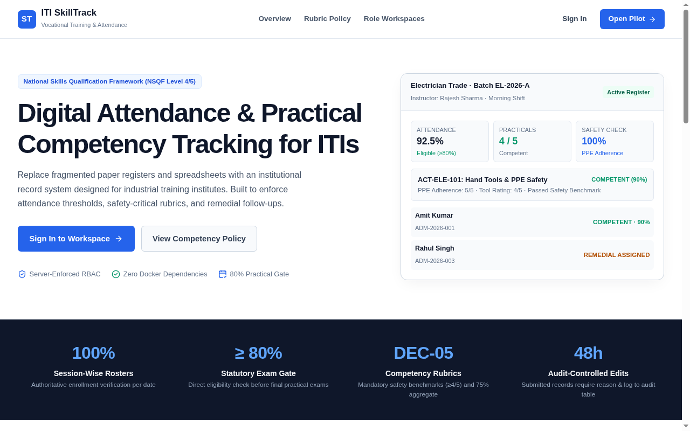
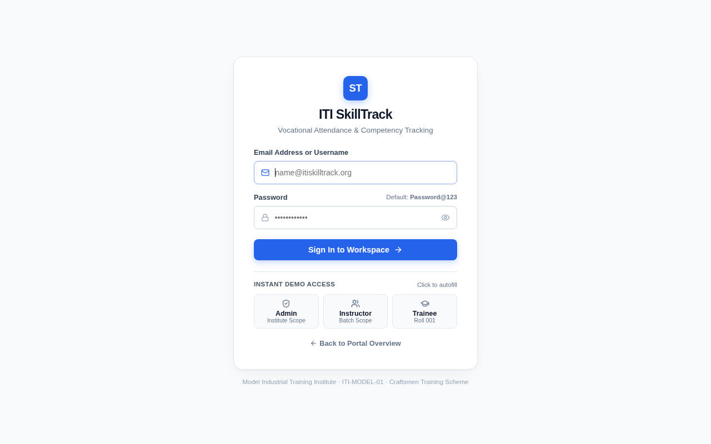

# ITI SkillTrack
> **Digital Skill Training, Attendance, and Practical Competency Tracking System for Industrial Training Institutes (ITIs)**  
> *Craftsmen Training Scheme (CTS) · National Skills Qualification Framework (NSQF Level 4/5)*

[](https://github.com/)
[](LICENSE)
[](docs/tasks.md)
[](#production-deployment--quick-start)

---

## 📸 System Screenshots & UI Walkthrough

### 1. Home Page & Practical Registry Overview

*Modern, high-contrast portal showcasing institutional statutory metrics, DEC-05 competency rubrics, training lifecycle, and pre-seeded role workspaces.*

### 2. Zero-Scroll Authentication & Instant Role Selection

*Single-viewport, zero-scroll login card featuring 1-click test credentials for Administrator, Vocational Instructor, and Student Trainee.*

### 3. Vocational Training Dashboard & Competency Overview

*Role-scoped workspace showing live session rosters, attendance percentage with the statutory 80% practical exam gate, and remedial task queues.*

---

## 🎯 Project Overview & Vision

**ITI SkillTrack** is a centralized digital record and monitoring platform engineered specifically for **Industrial Training Institutes (ITIs)**. It replaces paper attendance sheets, lost logbooks, and detached spreadsheets with an authoritative single source of truth.

The platform directly enforces real-world vocational invariants:
1. **Authoritative Session-Wise Attendance:** Tracks attendance per scheduled workshop lab, theory session, and practical block rather than generic daily tallies.
2. **Statutory 80% Practical Exam Gate:** Automatically calculates trainees' practical attendance percentage against the mandated 80% benchmark required to qualify for semester examinations.
3. **DEC-05 Objective Competency Rubrics:** Evaluates hands-on workshop attempts on a 0–5 criterion scale with **mandatory safety gates** ($\ge 4/5$) and a $75\%$ aggregate passing requirement.
4. **Supervised Remedial Workflows:** Automatically routes trainees who fail safety or benchmark criteria into supervised remedial practice with instructor resolution reviews.
5. **Strict Server-Side Scoping (IDOR Prevention):** Guarantees instructors view only their assigned trades/batches, and trainees view only their personal evaluations.

---

## 🏗️ Architecture & Technology Stack

The project is built as a **secure modular monolith** with zero container or Docker dependencies, running on any standard Apache, Nginx, or cPanel hosting environment.

```
                           ┌───────────────────────────┐
                           │   React 19 SPA (Vite)     │
                           │   Tailwind-Tokens & Icons │
                           └─────────────┬─────────────┘
                                         │ JSON REST API
                                         ▼
                           ┌───────────────────────────┐
                           │   PHP 8.3 Custom REST API │
                           │  PSR-4 Autoload / Routers │
                           └─────────────┬─────────────┘
                                         │ PDO Prepared Statements
                                         ▼
                     ┌───────────────────┴───────────────────┐
                     │                                       │
            ┌────────▼────────┐                     ┌────────▼────────┐
            │   MySQL 8.x     │                     │  SQLite (Zero   │
            │  (Production)   │                     │  Config Dev)    │
            └─────────────────┘                     └─────────────────┘
```

* **Frontend:** React 19 SPA (Vite), React Router v7, Lucide Icons, pure CSS design tokens.
* **Backend:** PHP 8.3 REST API with custom micro-router, CSRF middleware, session security, and structured JSON envelopes (`status`, `data`, `meta`).
* **Database Abstraction:** Dual-driver PDO architecture supporting **MySQL 8.x / MariaDB** (Production) and **SQLite 3** (Instant Zero-Config Testing) out-of-the-box.
* **Storage:** Private, access-controlled directory (`backend/storage/private_uploads/`) for practical exercise evidence and rubric documentation.

---

## 🚀 Completed Phases & Deliverables

All tasks from **Phase 0 through Phase 5** are fully implemented, verified against automated test suites, and packaged.

### **Phase 0 — Discovery & Institutional Policy Confirmation (Done)**
- [x] Confirmed single-institute deployment with multi-tenant architecture ([`01_policy_decision_register.md`](file:///home/shahdhairyah/Projects/ITI_SkillTrack_SSIP_2025_SFIC_2026/docs/phase-0/01_policy_decision_register.md) DEC-01).
- [x] Defined session-wise attendance tracking unit and 80% statutory practical threshold (DEC-02 / DEC-03).
- [x] Standardized 3-tier competency scale (`competent`, `needs_practice`, `not_attempted`) with mandatory safety benchmark (DEC-05).
- [x] Selected **ITI Electrician Trade (NSQF Level 4)** and Batch **EL-2026-A** as the model pilot cohort.

### **Phase 1 — Foundation & Project Setup (Done)**
- [x] React 19 client + PHP REST API skeleton with unified response/error envelope (`BASE-01` to `BASE-08`).
- [x] PDO connection manager with automatic fallback between MySQL and SQLite (`Database.php`).
- [x] Health check endpoints (`GET /api/v1/health`) and CORS middleware.

### **Phase 2 — Authentication, Roles & Institute Master Data (Done)**
- [x] Role-Based Access Control (RBAC): `administrator`, `instructor`, `student`, `monitoring_officer`.
- [x] Secure session cookies, CSRF tokens, Bcrypt password hashing (`AUTH-01` to `AUTH-05`).
- [x] Management screens and APIs for Trades, Academic Periods, Batches, Students, and Instructors (`ORG-01` to `ORG-08`).
- [x] IDOR protection and server-enforced record scoping.

### **Phase 3 — Training Sessions & Attendance Tracking (Done)**
- [x] Session scheduling with batch, instructor, date, and time blocks (`ATT-01` / `ATT-02`).
- [x] Authoritative session roster generation as of session date (`ATT-03`).
- [x] Draft saving with missing-mark validation and official submission locking (`ATT-06` / `ATT-07`).
- [x] Controlled corrections workflow requiring mandatory reason ($\ge 10$ chars) and append-only audit logging (`ATT-08`).
- [x] Approved attendance calculation formula:
  $$\text{Attendance } \% = \frac{\text{Count}(\text{present}) + \text{Count}(\text{late})}{\text{Total Sessions} - \text{Count}(\text{excused})} \times 100$$
- [x] Batch matrix attendance reports with formula-injection-sanitized CSV exports (`ATT-11`).

### **Phase 4 — Practical Activities & Competency Assessment (Done)**
- [x] Trade curriculum catalog: `Trade -> Modules -> Practical Activities -> Rubric Criteria` (`SKILL-01` to `SKILL-03`).
- [x] Authoritative 0–5 criterion rubric scoring with safety-critical gates (`SKILL-05` / `SKILL-06`).
- [x] **DEC-05 Completion Invariant:** Trainee is marked `Competent` only if:
  1. All mandatory safety criteria are scored $\ge 4/5$.
  2. Total aggregate percentage is $\ge 75\%$.
- [x] Multi-attempt tracking (`attempt_no`), criterion breakdown, and assessor feedback (`SKILL-08`).
- [x] Live Batch Competency Matrix grid comparing all trainees against trade activities.

### **Phase 5 — Remedial Support & Consolidated Dashboards (Done)**
- [x] Automatic and manual remedial task generation upon benchmark or safety failure (`REM-01` / `REM-02`).
- [x] Instructor review modal recording resolution outcome, notes, and state transitions (`assigned`, `in_progress`, `completed`, `cancelled`).
- [x] Trainee Skills & Competency Portfolio (`/student/skills`) detailing passed rubrics and active remedial tasks.
- [x] Role-specific dashboards for **Administrator**, **Vocational Trainer**, and **Student Trainee**.

---

## ⚡ Quick Start & Local Setup

### Prerequisites
* **Node.js** (v18+) & **npm**
* **PHP** (v8.1+) with `pdo_sqlite` and `pdo_mysql` extensions enabled.
* *(Optional)* MySQL 8.x or MariaDB.

### 1. Clone Repository & Install Frontend Dependencies
```bash
git clone https://github.com/shahdhairyah/ITI_SkillTrack_SSIP_2025_SFIC_2026.git
cd ITI_SkillTrack_SSIP_2025_SFIC_2026

# Install React dependencies
cd frontend
npm install
```

### 2. Launch Local Development Server
Open two terminal windows:

**Terminal 1: Start Backend API (Built-in PHP Server with Zero-Config SQLite)**
```bash
cd backend
php -S 127.0.0.1:8000 public/index.php
```

**Terminal 2: Start React Frontend**
```bash
cd frontend
npm run dev
```
Open **`http://localhost:5173`** in your browser.

---

## 🔑 Pre-Seeded Pilot Accounts

The database comes pre-populated with pilot data for **Electrician Trade (ELE-01)**, Batch **EL-2026-A**.

| Role | Email / Username | Password | Access Scope |
|---|---|---|---|
| **Institute Administrator** | `admin@itiskilltrack.org` | `Password@123` | Full institute governance, trades, batches, users, and audit logs |
| **Vocational Instructor** | `rajesh.sharma@itiskilltrack.org` | `Password@123` | Assigned batch EL-2026-A: session registers, practical rubrics, remedial queue |
| **Student Trainee (Amit)** | `amit.kumar@student.iti.org` | `Password@123` | Personal profile, attendance (92.5%), exam eligibility, verified practical portfolio |
| **Student Trainee (Rahul)** | `rahul.singh@student.iti.org` | `Password@123` | Trainee with open remedial assignment (Wire Stripping & PPE Safety Gap) |

*You can also click any of the **Quick Test Accounts** directly on the sign-in page to autofill credentials instantly.*

---

## 📦 Production Deployment Package (`deploy/` & `.zip`)

A complete production deployment bundle is generated in [`deploy/`](deploy/README.md) and packaged as **`iti_skilltrack_deploy.zip`**:

### Deployment Bundle Structure
* **`deploy/htdocs/`**: Production frontend assets (`index.html`, `assets/`) and backend REST API (`api/`) ready to upload directly into the server's public root (`htdocs` or `public_html`).
* **`deploy/htdocs/.htaccess` & `api/.htaccess`**: Automatic SPA fallback for React Router and secure routing for `/api/...`.
* **Zero-Config Instant Launch:** Includes a pre-seeded SQLite database (`htdocs/api/database/iti_skilltrack.sqlite`), allowing instant login upon upload without immediate database configuration.
* **Production MySQL Dump:** [`deploy/database/iti_skilltrack_full.sql`](deploy/database/iti_skilltrack_full.sql) contains all 27 tables, Phase 1–5 columns, and pilot seed accounts for 1-click phpMyAdmin import.
* **Server Configurations:** Includes example virtual host configs for **Nginx** ([`deploy/nginx.conf.example`](deploy/nginx.conf.example)) and **Apache** ([`deploy/apache.vhost.example`](deploy/apache.vhost.example)).

### 1-Click Upload Instructions (cPanel / Apache / Nginx)
1. Upload and extract `iti_skilltrack_deploy.zip` into your web server document root (e.g. `/var/www/html` or `public_html`).
2. *(Optional MySQL configuration)*: Import `deploy/database/iti_skilltrack_full.sql` into MySQL and configure `.env`:
   ```ini
   DB_CONNECTION=mysql
   DB_HOST=127.0.0.1
   DB_PORT=3306
   DB_DATABASE=iti_skilltrack
   DB_USERNAME=iti_user
   DB_PASSWORD=your_password
   ```
3. Navigate to your server domain or IP address in your browser.

---

## 📂 Project Directory Structure

```
├── backend/
│   ├── database/
│   │   ├── migrations/          # 001_initial, 002_attendance, 003_competency
│   │   ├── seeds/               # Pilot seed data for Electrician batch
│   │   └── iti_skilltrack_full.sql # Unified MySQL 8.x schema dump
│   ├── public/
│   │   └── index.php            # Front controller and router entry point
│   ├── src/
│   │   ├── Controllers/         # Auth, Attendance, Competency, Remedial, Org
│   │   ├── Middleware/          # Auth, Role, CSRF, CORS, Request ID
│   │   ├── Services/            # Business logic, DEC-05 rules, DB abstraction
│   │   └── Support/             # Router, JSON Response Envelope
│   └── storage/
│       └── private_uploads/     # DEC-08 access-checked practical evidence files
├── frontend/
│   ├── public/                  # Favicons, SVG icons
│   ├── src/
│   │   ├── components/          # PageHeader, StatCard, Badge, Button, Modal
│   │   ├── features/
│   │   │   ├── attendance/      # SessionsPage, AttendanceRegister, Report
│   │   │   ├── auth/            # LoginPage (Zero-scroll design)
│   │   │   ├── competency/      # CurriculumPage, AssessmentWorkspace, StudentSkills
│   │   │   ├── dashboard/       # AdminDashboard, InstructorDashboard, StudentDashboard
│   │   │   ├── home/            # HomePage (Institutional portal layout)
│   │   │   ├── organization/    # Trades, Periods, Batches, Settings
│   │   │   └── remedial/        # RemedialSupportPage (Task queue & review)
│   │   └── lib/                 # API client, date & string formatters
├── deploy/                      # Production-ready web root & database dump
├── docs/                        # Architecture, PRD, tasks, policy registers
└── iti_skilltrack_deploy.zip    # Pre-packaged production deployment zip
```

---

## 📜 Invariants & Institutional Business Rules

* **Uniqueness:** An attendance record is strictly unique for `(session_id, student_id)`.
* **Missing Marks:** A missing mark is **not** automatically assumed to be Present; it must be resolved before submission.
* **Audit Trail:** Corrections submitted after official lock require a reason ($\ge 10$ characters) and log to `audit_logs`.
* **DEC-05 Safety Rule:** A practical evaluation cannot receive `Competent` if any safety criterion scores below $4/5$.
* **Data Isolation:** Disabled accounts preserve historical practical evidence without leaking authorization.

---

## 👥 Contributors & SSIP 2025 SFIC 2026 Initiative

Developed for the **Student Startup and Innovation Policy (SSIP 2025)** / **Smart Future Innovation Challenge (SFIC 2026)** to modernize technical vocational training records across Industrial Training Institutes.
